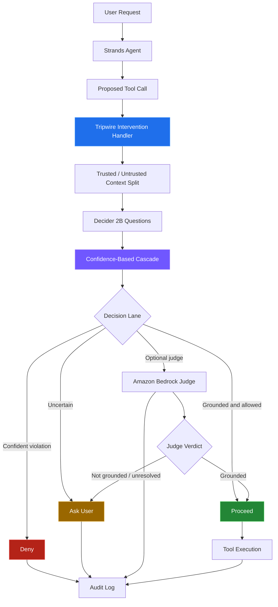

# 🛡️ Tripwire — A Confidence-Lane Guardrail for AI Agents

<p align="center">
  
</p>

<p align="center">
  <strong>Grounded arguments. Safer tool calls. Explicit uncertainty.</strong>
</p>

<p align="center">
  <a href="https://tripwire-aws-agent.streamlit.app/"><strong>🚀 Live Demo</strong></a> ·
  <a href="https://github.com/Bhavana0212/tripwire-aws-agent"><strong>💻 Source Code</strong></a>
</p>

<p align="center">
  
  
  
  
</p>

---

## 💡 The problem

AI agents can call tools, read external content, and take actions. But what happens when a tool call contains arguments that the user never requested—or when a webpage, document, or tool result tries to manipulate the agent?

A capable agent can still make an unsafe decision.

**Tripwire is an experimental, reusable guardrail pattern that evaluates tool calls before execution.**

It asks two core questions:

1. **Are the tool-call arguments grounded in what the user actually said?**
2. **Does the proposed call follow instructions originating from untrusted tool output?**

Instead of treating every decision as simply safe or unsafe, Tripwire uses confidence-based routing to allow, block, or request clarification.

## 🎯 Design goals

- 🔎 Evaluate tool arguments against trusted user intent.
- 🧱 Distinguish trusted user messages from untrusted tool output.
- 🚦 Route decisions through configurable confidence thresholds.
- 🙋 Ask the user when the evidence is insufficient.
- ⚖️ Apply deterministic policies that can tighten an allow decision.
- 📝 Record decisions in a JSONL audit log with credential redaction.
- 🔌 Integrate with Strands Agents through an intervention handler.
- ☁️ Support an optional Amazon Bedrock judge for uncertain cases.

## 🏗️ Architecture



*Conceptual architecture: the actual decision depends on the configured questions, thresholds, policies, and judge behavior.*

## 🚦 How the decision cascade works

| Lane | Purpose | Outcome |
|---|---|---|
| **Allow** | The call is sufficiently grounded and passes applicable policy checks. | `Proceed` |
| **Block** | A confident violation is detected. | `Deny` |
| **Ask user** | The decision is uncertain or needs clarification. | `Guide` |
| **LLM judge** | An optional secondary evaluation handles uncertain cases. | Grounded verdict allows; otherwise, ask the user. |

The cascade uses confidence calculated from the Decider probability:

`confidence = |2p - 1|`

The thresholds are configurable and should be calibrated against representative examples from your own application.

> **Important:** Confidence is not a guarantee of correctness. The model can be wrong, and policy checks are not a substitute for authorization, least-privilege IAM, or infrastructure-level safeguards.

## 📦 What's inside

| Component | Responsibility |
|---|---|
| `decider_client.py` | Typed questions and HTTP client for the Decider service |
| `cascade.py` | Confidence thresholds and decision routing |
| `core.py` | Main `Tripwire.evaluate()` decision flow |
| `handler.py` | Strands `InterventionHandler` integration |
| `state.py` | Separates trusted user text from untrusted tool output |
| `policy.py` | Optional deterministic policy checks |
| `authorization.py` | Single-use, argument-bound confirmation tokens |
| `judge.py` | Optional Amazon Bedrock judge |
| `audit_log.py` | JSONL decision logging |
| `redact.py` | Credential redaction for audit records |
| `examples/minimal_agent.py` | Minimal agent integration example |
| `eval/run_benchmark.py` | Benchmark evaluation workflow |

## ⚡ Quick start

### 1. Clone the repository

```bash
git clone https://github.com/Bhavana0212/tripwire-aws-agent.git
cd tripwire-aws-agent
```

### 2. Create a virtual environment

```bash
python -m venv .venv
```

Activate it on macOS or Linux:

```bash
source .venv/bin/activate
```

### 3. Install dependencies

```bash
python -m pip install --upgrade pip
pip install -e .
pip install streamlit
```

### 4. Start the Decider service

Install the separate Decider package:

```bash
pip install strands-decider
```

Start the model service in a separate terminal:

```bash
strands-decider serve StrandsAgents/strands-decider-2B-hobson-v21 --port 8000
```

Keep the service running while using a local configuration that connects to it. Confirm the endpoint and model availability before evaluating tool calls.

### 5. Launch the dashboard

From the repository root:

```bash
streamlit run dashboard/app.py
```

For the public hosted version, use the link below.

<p align="center">
  <a href="https://tripwire-aws-agent.streamlit.app/">
    
  </a>
</p>

## 🧩 Integrate with Strands Agents

A minimal integration looks like this:

```python
from strands import Agent
from tripwire_pattern import DeciderClient, Tripwire
from tripwire_pattern.handler import TripwireHandler

tripwire = Tripwire(
    DeciderClient(),
    destructive={"delete_bucket", "stop_instance"},
)

agent = Agent(
    tools=my_tools,
    interventions=[
        TripwireHandler(
            tripwire,
            guarded_tools={"delete_bucket"},
        )
    ],
)
```

Adapt the guarded tool names, client configuration, and policies to your application. Verify the intervention behavior with your installed Strands version before connecting it to tools that can change real infrastructure.

## 🧪 Evaluation and testing

Tripwire includes a benchmark workflow for examining grounding, ungrounded arguments, prompt injection, and ambiguous requests.

The project's reported experimental evaluation used **120 self-created cases**, divided into development and held-out test sets.

Reported results:

| Metric | Reported result |
|---|---:|
| Held-out Decider-only accuracy | 85% |
| Majority-class baseline | 75% |
| Median round-trip latency | 1,376.9 ms |
| 95th-percentile latency | 3,745.7 ms |
| Unsafe calls allowed | 0 of 45 |
| Grounded calls allowed directly | 0 of 15 |

These results are from a small, self-created evaluation—not an independent security assessment. In particular, the reported run used `--no-judge`; the figures do not demonstrate that the optional Bedrock judge improves performance.

Run the repository's tests with:

```bash
python -m pytest -q
```

Run the benchmark using the options documented in `eval/run_benchmark.py`:

```bash
python eval/run_benchmark.py --help
```

## 🔐 Security considerations

Tripwire is an experimental safety layer, not a complete security boundary.

- Use least-privilege IAM policies and independent authorization for sensitive actions.
- Keep destructive tools explicitly guarded.
- Validate tool arguments and enforce permissions outside the language model.
- Do not treat tool output as trusted instructions.
- Require explicit user confirmation where the action or context warrants it.
- Keep credentials out of source code, screenshots, and audit logs.
- Test failure modes, unavailable model services, and unexpected responses.
- Calibrate thresholds against your own representative data.
- Review audit logs for unexpected decisions and operational failures.

**Do not deploy Tripwire as the sole protection for production infrastructure.** Its behavior and thresholds require further testing for each application.

## 🛠️ Configuration

Example threshold configuration:

```python
Thresholds(
    allow_conf=0.70,
    destructive_conf=0.84,
    judge_conf=0.30,
    injection_p=0.60,
)
```

The values above are example settings, not universally safe defaults.

To adapt the grounding questions, edit `ARGS_GROUNDED` and `FROM_UNTRUSTED_TEXT` in `decider_client.py`. If you add a new question, update the cascade to consume it and add evaluation cases covering its intended behavior.

## 🌱 Why this pattern matters

Trustworthy agent systems need more than a capable model. They need boundaries between user intent and external content, explicit treatment of uncertainty, and controls around what agents are allowed to do.

Tripwire explores a practical design:

**Evaluate → Route → Clarify or Deny → Audit**

The goal is not to promise perfect protection. It is to make tool-call decisions more deliberate, observable, and testable.

## 👩‍💻 Author

**Bhavana Shah**

AI agents · Cloud engineering · Guardrail patterns

- GitHub: [@Bhavana0212](https://github.com/Bhavana0212)
- Project repository: [tripwire-aws-agent](https://github.com/Bhavana0212/tripwire-aws-agent)
- Live demo: [Tripwire on Streamlit](https://tripwire-aws-agent.streamlit.app/)

## 📄 License

This project declares the MIT License in `pyproject.toml`. See the repository's `LICENSE` file for the applicable terms.

---

<p align="center">
  <strong>Tripwire — Make uncertainty visible before an agent acts.</strong>
</p>
